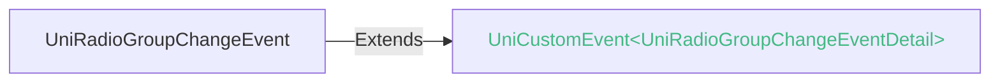

<!-- ## radio-group -->

::: sourceCode
## radio-group

> issues: https://issues.dcloud.net.cn/?mid=component.form-component.radio.radio-group

> 源码: https://github.com/dcloudio/uni-app/tree/uni-app-x-alpha/src/uni_modules/uni-form/components/radio-group

:::

> 组件类型：UniRadioGroupElement 

 单选框组

同一个radio-group下的多个radio为单选效果，选中一个radio后其他radio将失去选中效果。

### 兼容性 <Help />
Web: 4.0; 微信小程序: 4.41; 支付宝小程序: 5.31; Android: 3.9; iOS: 4.11; HarmonyOS: 4.61

### 属性 
| 名称 | 类型 | 兼容性 | 描述 |
| :- | :- |  :-: | :- |
| name | string | Web: 4.0; 微信小程序: 4.41; 支付宝小程序: 5.31; Android: 3.9; iOS: 4.11; HarmonyOS: 4.61 | 表单的控件名称，作为键值对的一部分与表单(form组件)一同提交 |
| @change | (event: [UniRadioGroupChangeEvent](#uniradiogroupchangeevent)) => void | Web: 4.0; 微信小程序: 4.41; 支付宝小程序: 5.31; Android: 3.9; iOS: 4.11; HarmonyOS: 4.61 | radio-group 中的选中项发生变化时触发 change 事件，event.detail = {value: 选中项radio的value} |

### 事件
#### UniRadioGroupChangeEvent

##### UniRadioGroupChangeEventDetail

###### UniRadioGroupChangeEventDetail 的属性值
| 名称 | 类型 | 必填 |
| :- | :- | :- |
| value | string | 是 |

<!-- UTSCOMJSON.radio-group.component_type-->

### 子组件 @children-tags
| 子组件 | 兼容性 |
| :- | :- |
| [*](*.md) | Web: 4.0; 微信小程序: 4.41; 支付宝小程序: x; Android: 3.9; iOS: 4.11; HarmonyOS: 4.61 |

### 参见
- [参见uni-app相关文档](https://uniapp.dcloud.io/component/radio.html)

